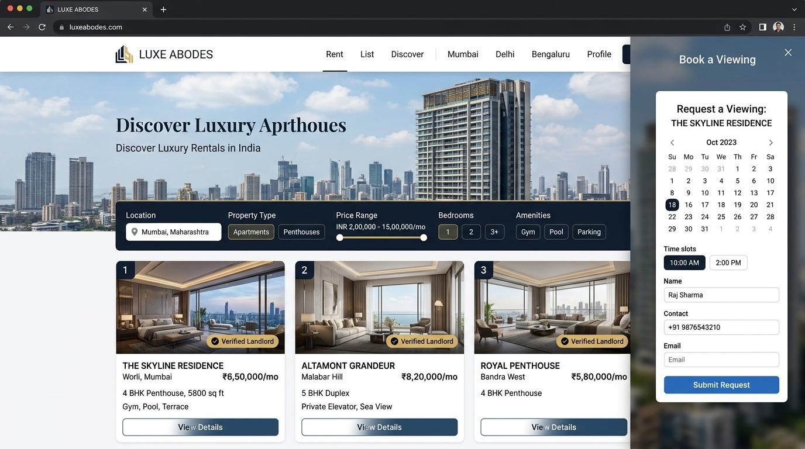
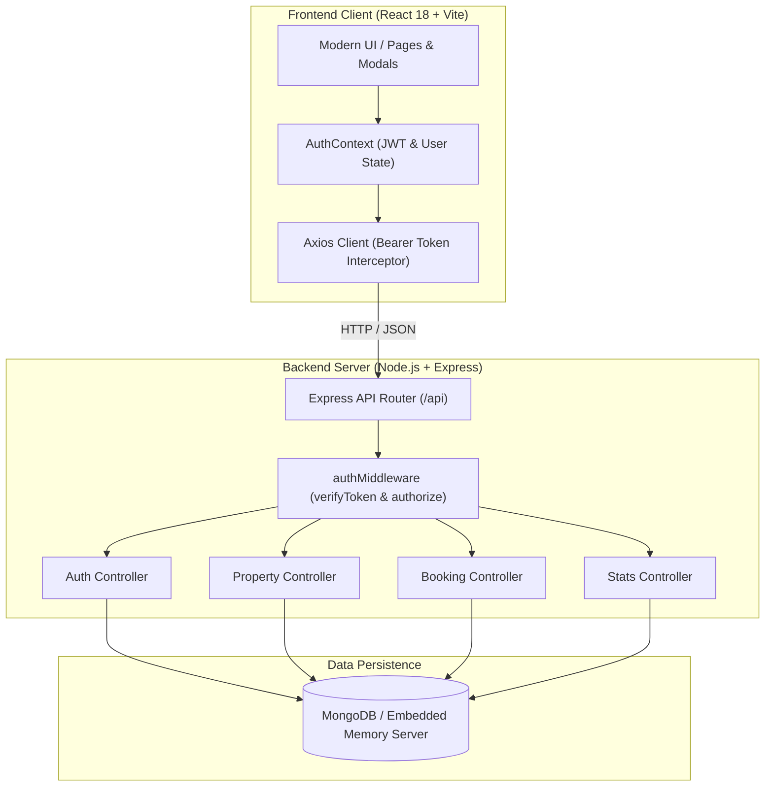

# 🏠 HouseHunt - House Rental & Property Management System

<div align="center">


<br/>

**A premium, full-stack MERN platform connecting Tenants, Property Owners, and Platform Administrators for seamless house rentals, instant lease bookings, and end-to-end property lifecycle management.**

[Key Features](#-key-features) • [System Architecture](#-system-architecture) • [Demo Credentials](#-demo-accounts) • [Quick Start](#-quick-start-guide) • [API Reference](#-rest-api-documentation) • [Project Structure](#-project-structure)

</div>

---

## 📌 Project Deliverables & Submission Links

| Deliverable | Resource Link | Details |
|---|---|---|
| 📄 **Project Documentation** | [Google Drive Document Folder](https://drive.google.com/drive/folders/1f628nrKGN7GKkjcBvWrE-TDvGbOnQmGa?usp=sharing) | Comprehensive project report, SRS, and architecture documentation |
| 🎥 **Project Demo Video** | [Google Drive Video Folder](https://drive.google.com/drive/folders/1OJ9HhmjlHmJNF3zqCxKjB3lJgKmYYCOd?usp=drive_link) | Complete product demonstration and feature walkthrough video |

---

<div align="center">
  
</div>

---

## 📖 Table of Contents

1. [Overview & Solution](#-overview)
2. [Project Deliverables & Submission Links](#-project-deliverables--submission-links)
3. [Key Features](#-key-features)
4. [Role-Based Access Control (RBAC)](#-role-based-access-control-rbac)
5. [Demo Accounts](#-demo-accounts)
6. [Technology Stack](#-technology-stack)
7. [System Architecture](#-system-architecture)
8. [Quick Start Guide](#-quick-start-guide)
9. [Environment Variables](#-environment-variables)
10. [REST API Documentation](#-rest-api-documentation)
11. [Project Structure](#-project-structure)
12. [Integration Testing](#-integration-testing)
13. [License & Acknowledgments](#-license)

---

## 💡 Overview

Finding and managing rental homes traditionally suffers from fragmented communication, opaque pricing, high middleman commissions, and tedious manual paperwork. 

**HouseHunt** addresses these challenges by delivering a centralized, modern digital rental ecosystem:
- **Tenants** discover verified homes with virtual walkthroughs, calculated deposits, and transparent lease agreements.
- **Landlords** list properties, receive direct tenant inquiries without intermediary brokerage fees, and track rental bookings and earnings.
- **Administrators** ensure platform safety through a listing moderation queue and real-time operational analytics.

---

## 🌟 Key Features

### 🔍 1. Discovery & Search Engine
- **Multi-Attribute Filters**: Filter listings dynamically by City, State, Property Type (*Apartment, Villa, Studio, Penthouse, House*), Price Range Slider, Bedrooms (*1, 2, 3, 4+ BHK*), and Furnishing Status (*Furnished, Semi-Furnished, Unfurnished*).
- **Full-Text Keyword Search**: Indexed search across property titles, addresses, and feature descriptions.
- **Dynamic Sorting**: Sort by newest, price (low-to-high / high-to-low), tenant ratings, or square footage.

### 🏡 2. Immersive Property Listings
- **High-Definition Galleries**: Multi-image showcases with interactive thumbnail previewers.
- **Virtual Tours**: Embedded walkthrough video tours for contactless virtual inspection.
- **Verified Host Cards**: Direct landlord contact information (email and phone number) with 0% middleman brokerage.
- **Community Ratings & Reviews**: Authentic verified tenant feedback with 1–5 star ratings and detailed written reviews.

### 📅 3. Interactive Move-In & Booking Engine
- **Move-In Date Picker**: Select custom move-in timelines and lease durations (6 to 36 months).
- **Real-Time Financial Calculator**: Instant transparent computation of monthly rent, refundable security deposits, and move-in total.
- **Booking Lifecycle Management**: Real-time status progression (`pending` ➔ `confirmed` ➔ `rejected` / `cancelled`).

### 📊 4. Multi-Role Dashboard Hub
- **Landlord Hub**: Monitor active listings, approve/decline incoming tenant lease applications, and monitor estimated monthly rental revenue.
- **Tenant Hub**: View active booking status, move-in timelines, and landlord contact details.
- **Admin Command Center**: Listing moderation queue for approving or rejecting newly submitted properties before public display, plus system-wide statistics.

---

## 🔐 Role-Based Access Control (RBAC)

HouseHunt enforces strict role-based access control across both frontend client routes and backend REST endpoints:

| Role | Browse & Filter | Submit Bookings | Post / Manage Listings | Review Tenant Bookings | Admin Moderation |
|---|:---:|:---:|:---:|:---:|:---:|
| **Guest / Visitor** | ✅ | ❌ | ❌ | ❌ | ❌ |
| **Tenant** | ✅ | ✅ | ❌ | ❌ | ❌ |
| **Landlord / Owner** | ✅ | ❌ | ✅ | ✅ | ❌ |
| **Platform Admin** | ✅ | ✅ | ✅ | ✅ | ✅ |

---

## 🚀 Demo Accounts

For immediate evaluation, the application includes pre-seeded demo accounts accessible via **1-Click Quick Fill** buttons directly on the Login page:

| Role | Email | Password | Primary Permissions |
|---|---|---|---|
| **Platform Admin** | `admin@househunt.com` | `Admin@123` | Moderate pending listings, manage all inventory, view global analytics |
| **Landlord / Owner** | `landlord@househunt.com` | `Landlord@123` | Create & edit listings, review tenant applications, revenue metrics |
| **Tenant / Renter** | `renter@househunt.com` | `Renter@123` | Search properties, submit booking applications, post ratings & reviews |

---

## 🛠️ Technology Stack

```
Frontend (Client)
├── React 18 (Component-Driven Architecture)
├── Vite (Lightning-fast HMR Build Tool)
├── React Router DOM v6 (Client-Side Route Protection)
├── Axios (HTTP Client with JWT Request/Response Interceptors)
├── Bootstrap 5 & Custom Modern CSS (Responsive Design Tokens)
└── Lucide React (Clean Vector Iconography)

Backend (REST API)
├── Node.js (Runtime Environment)
├── Express.js (Modular REST API Framework)
├── Mongoose ODM (Object Data Modeling & Validation)
├── JSONWebToken (Stateless Authentication & RBAC)
├── BcryptJS (Password Hashing with 10 Salt Rounds)
├── Morgan (HTTP Request Logging)
└── Dotenv & CORS (Configuration & Cross-Origin Security)

Database Layer
├── MongoDB (NoSQL Document Store with Text Indexes)
└── MongoDB Memory Server (Zero-Friction Embedded Fallback for Instant Local Execution)
```

---

## 🏗️ System Architecture



---

## ⚙️ Quick Start Guide

### Prerequisites
- [Node.js](https://nodejs.org/) (version 18.x or 20.x recommended)
- [Git](https://git-scm.com/)

### 1. Clone the Repository
```bash
git clone https://github.com/sarathi1927/house_rent.git
cd house_rent
```

### 2. Install All Dependencies
Install root, backend, and frontend packages with a single command:
```bash
npm run install-all
```
*(Or install manually via `npm install`, `cd backend && npm install`, and `cd ../frontend && npm install`).*

### 3. Environment Configuration
Verify that the `backend/.env` file is present (or copy from `backend/.env.example`):
```bash
# Inside backend/.env
PORT=5000
NODE_ENV=development
MONGO_URI=mongodb://127.0.0.1:27017/househunt
JWT_SECRET=househunt_super_secret_jwt_key_2026_safe_and_secure!
JWT_EXPIRES_IN=7d
CLIENT_URL=http://localhost:5173
```
> **Note**: If a local MongoDB daemon is not running on port 27017, the backend will automatically spin up an embedded **MongoDB Memory Server** and auto-seed demo listings on first boot!

### 4. Run the Full Application (Concurrent Mode)
From the project root:
```bash
npm run dev
```

The terminal will launch both servers:
- 💻 **Frontend Web App**: [http://localhost:5173](http://localhost:5173)
- ⚙️ **Backend REST API**: [http://localhost:5000](http://localhost:5000)
- 🩺 **API Health Check**: [http://localhost:5000/api/health](http://localhost:5000/api/health)

---

## 📡 REST API Documentation

### 🔐 Authentication (`/api/auth`)
| Method | Endpoint | Access | Description |
|---|---|---|---|
| `POST` | `/api/auth/register` | Public | Register a new user (`tenant` or `owner`) |
| `POST` | `/api/auth/login` | Public | Authenticate user and issue JWT |
| `GET` | `/api/auth/me` | Protected | Retrieve authenticated user profile |
| `PUT` | `/api/auth/profile` | Protected | Update profile name, phone, or avatar |

### 🏡 Properties (`/api/properties`)
| Method | Endpoint | Access | Description |
|---|---|---|---|
| `GET` | `/api/properties` | Public | Retrieve approved properties with search & filters |
| `GET` | `/api/properties/:id` | Public | Retrieve detailed property information |
| `GET` | `/api/properties/:id/reviews` | Public | Fetch all verified reviews for a property |
| `POST` | `/api/properties` | Owner / Admin | Create a new property listing |
| `GET` | `/api/properties/user/my-properties` | Owner / Admin | Retrieve listings created by current landlord |
| `PUT` | `/api/properties/:id` | Owner / Admin | Update owned property details |
| `DELETE` | `/api/properties/:id` | Owner / Admin | Delete owned property listing |
| `GET` | `/api/properties/admin/pending` | Admin Only | List pending properties requiring moderation |
| `PUT` | `/api/properties/:id/status` | Admin Only | Approve or reject a property listing |
| `POST` | `/api/properties/:id/reviews` | Protected (Tenant)| Submit a rating and review |

### 📅 Bookings (`/api/bookings`)
| Method | Endpoint | Access | Description |
|---|---|---|---|
| `POST` | `/api/bookings` | Protected (Tenant)| Submit a rental booking application |
| `GET` | `/api/bookings/my-bookings` | Protected (Tenant)| Fetch current tenant's booking history |
| `GET` | `/api/bookings/owner-requests` | Owner / Admin | Fetch tenant booking requests for owner's properties |
| `PUT` | `/api/bookings/:id/status` | Owner / Admin | Accept or reject a tenant booking request |
| `PUT` | `/api/bookings/:id/cancel` | Protected | Cancel a pending booking |

### 📈 Statistics & Metrics (`/api/stats`)
| Method | Endpoint | Access | Description |
|---|---|---|---|
| `GET` | `/api/stats/platform` | Public | Total approved properties, cities, and average rent |
| `GET` | `/api/stats/owner` | Owner / Admin | Total listings, active bookings, and estimated monthly revenue |

---

## 📁 Project Structure

```
house_rent/
├── .gitignore
├── package.json                        # Root workspace manager (Concurrently)
├── package-lock.json
├── README.md                           # Main documentation & deliverable links
├── docs/
│   └── preview.jpg                     # High-resolution platform preview banner
│
├── backend/                            # Node.js & Express REST API Server
│   ├── config/
│   │   └── db.js                       # Mongoose connection & embedded fallback
│   ├── controllers/
│   │   ├── authController.js           # Registration, login & profile management
│   │   ├── propertyController.js       # CRUD, filtering, admin approval logic
│   │   ├── bookingController.js        # Move-in requests, calculations, approvals
│   │   ├── reviewController.js         # Ratings & reviews management
│   │   └── statsController.js          # Platform and landlord metrics
│   ├── middleware/
│   │   ├── authMiddleware.js           # JWT token verification & RBAC guard
│   │   └── errorMiddleware.js          # Centralized error formatting
│   ├── models/
│   │   ├── User.js                     # User schema (roles, bcrypt password)
│   │   ├── Property.js                 # Property schema (full specs, text indexes)
│   │   ├── Booking.js                  # Booking schema (dates, financials, status)
│   │   └── Review.js                   # Review schema (ratings, comments)
│   ├── routes/
│   │   ├── authRoutes.js
│   │   ├── propertyRoutes.js
│   │   ├── bookingRoutes.js
│   │   └── statsRoutes.js
│   ├── seed/
│   │   └── seedData.js                 # Automated seed data (users & properties)
│   ├── server.js                       # Express application bootstrap
│   ├── test-integration.js             # Automated integration test suite
│   ├── .env                            # Backend environment variables
│   └── package.json
│
└── frontend/                           # React 18 + Vite Single Page Application
    ├── public/
    ├── src/
    │   ├── components/
    │   │   ├── common/
    │   │   │   ├── Navbar.jsx          # Dynamic navigation with role-specific tabs
    │   │   │   ├── Footer.jsx          # Platform footer & social links
    │   │   │   └── ProtectedRoute.jsx  # Client-side authentication guard
    │   │   ├── properties/
    │   │   │   ├── PropertyCard.jsx    # Listing preview card with badges
    │   │   │   └── PropertyFilterBar.jsx# Multi-filter search & budget controls
    │   │   └── bookings/
    │   │       └── BookingModal.jsx    # Move-in scheduler & deposit breakdown modal
    │   ├── context/
    │   │   └── AuthContext.jsx         # Global auth state & persistent session
    │   ├── pages/
    │   │   ├── HomePage.jsx            # Hero section, stats, featured listings
    │   │   ├── PropertiesPage.jsx      # Live catalog with dynamic filtering
    │   │   ├── PropertyDetailsPage.jsx # Photo gallery, specs, tour, host card, reviews
    │   │   ├── AddEditPropertyPage.jsx # Multi-field landlord property submission form
    │   │   ├── DashboardPage.jsx       # Unified dashboard (Tenant/Owner/Admin views)
    │   │   ├── LoginPage.jsx           # Sign in with 1-click demo role pills
    │   │   ├── RegisterPage.jsx        # Role selection registration
    │   │   └── NotFoundPage.jsx        # Modern 404 error page
    │   ├── services/
    │   │   └── api.js                  # Axios instance with auth interceptor
    │   ├── App.jsx                     # Route definitions
    │   ├── App.css                     # Custom component styles
    │   ├── index.css                   # Global design tokens & modern layout rules
    │   └── main.jsx                    # React DOM entry point
    ├── index.html                      # HTML template with Google Fonts
    ├── vite.config.js                  # Vite configuration & dev proxy
    └── package.json
```

---

## 🧪 Integration Testing

The backend includes a comprehensive, automated end-to-end integration test suite verifying authentication, property creation, tenant booking requests, landlord status updates, and moderation guards.

Run the test suite directly:
```bash
cd backend
node test-integration.js
```

---

## 📄 License

This project is licensed under the [MIT License](LICENSE) - open for educational, personal, and commercial portfolio use.
